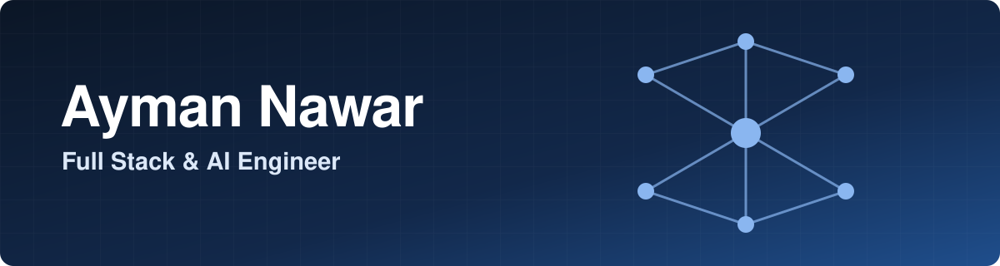

  

## About

I'm a Senior Full Stack & AI Engineer with 7 years building SaaS, e-commerce, FinTech, booking and enterprise products across Egypt and the GCC.

I build Node.js/NestJS services, React.js/Next.js interfaces and LLM features (RAG, AI agents) end to end.

## Career

| Company | Period | Focus |
|:--|:--|:--|
| **Fincart** | 2026 – Present | Revenew Shopify app and merchant portal, and an AI customer service platform |
| **Rahala** | 2026 – Present | Hotel and flight booking platform with Next.js, NestJS, PostgreSQL and Elasticsearch |
| **Digital Car** | 2025 | Car marketplace, pricing engine and scraping engine |
| **Amjaad Technology** | 2024 – 2025 | Smart meter platform modernization, community app and payments |
| **Huawei** | 2023 – 2024 | Regional HR platform with workflow automation and an internal design system |
| **Dot** | 2021 – 2023 | Restaurant POS and an HR system with real-time attendance |
| **Huawei** | 2020 – 2021 | Full stack and AI/ML product work |

## Volunteering

**Instructor and Mentor**, NASA Space Apps Challenge | 2023 – Present
