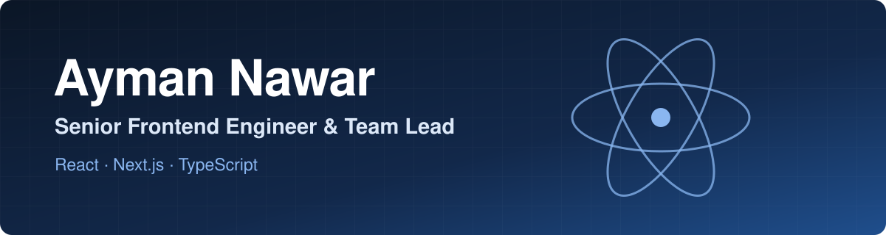

  

## About

I'm a senior full-stack engineer with 6+ years building SaaS, e-commerce, FinTech, POS, ERP, CRM, HR, travel and marketplace platforms.

I own backend services, data models and React/Next.js interfaces through deployment and production support, and I build applied AI systems with Python/FastAPI, RAG and LLM agents.

## Impact

| 450 | ~70 | 10k+ | ~$1M |
|:--:|:--:|:--:|:--:|
| Merchants on Revenew, a Shopify app I build | Businesses served by Rahala | Monthly POS transactions | HR cost savings at Huawei |

## Tech Stack

**Backend**

**Data**

**Cloud and DevOps**

**Applied AI**

**Frontend and Languages**

**UI**

**State and Data**

**Quality**

## Career

| Company | Period | Focus |
|:--|:--|:--|
| **Fincart** | 2026 – Present | Revenew Shopify app, Merchant Portal and an AI customer service solution |
| **Rahala** | 2026 – Present | Hotel and flight booking platform, built end to end |
| **Digital Car** | 2024 – 2025 | Car marketplace, pricing engine and scraping engine |
| **Amjaad Technology** | 2023 – 2024 | Smart meter platform migration to Next.js, community app and payments |
| **Huawei** | 2022 – 2023 | Regional HR system and an internal Tailwind CSS design system |
| **Dot** | 2021 – 2022 | Restaurant POS and an HR system with real-time attendance |
| **Huawei** | 2020 – 2021 | React applications and Node.js and Python REST services |

## Volunteering

**Instructor and Mentor**, NASA Space Apps Challenge | 2023 – Present
